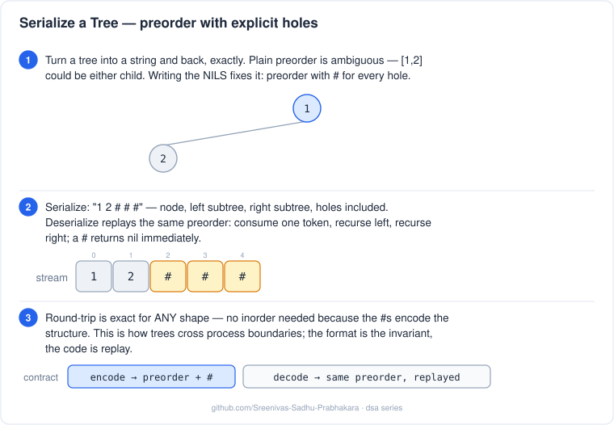

# Serialize and Deserialize a Binary Tree

> Striver SDE Sheet 145 · Day 21 BST II — preorder with explicit nil markers; the markers are what let one traversal carry the whole shape. Go, stdlib only, tested.

## Problem

Encode an arbitrary binary tree to a string and decode it back to an identical tree. (One traversal normally can't determine a tree — that's why #125 needed two.)

## Approach

Preorder, but writing a `#` for every nil child. Those markers change the game: they tell the decoder exactly where each subtree ends, so the single traversal becomes unambiguous. Decoding mirrors encoding — consume a token; `#` means nil, otherwise make the node and recursively build left then right — with one shared cursor that self-synchronizes, no lengths or offsets stored anywhere. Round-trip tests over assorted shapes (chains, negatives, empty) are the natural verification, plus a check that same-values-different-shape trees encode differently — the property a correct codec must have.

**Complexity:** O(n) both ways; encoded size O(n).

## Visual walkthrough

Read the picture top to bottom — each numbered frame is one moment of the algorithm
running on this repo's test example.

## Run

    go test ./...   # verify
    go run .        # demo

---

One of 191 repos solving Striver's SDE Sheet in Go — stdlib only, one problem per repo, every solution tested. Browse the set: [`dsa-*` repos](https://github.com/Sreenivas-Sadhu-Prabhakara?tab=repositories&q=dsa-&type=source).
